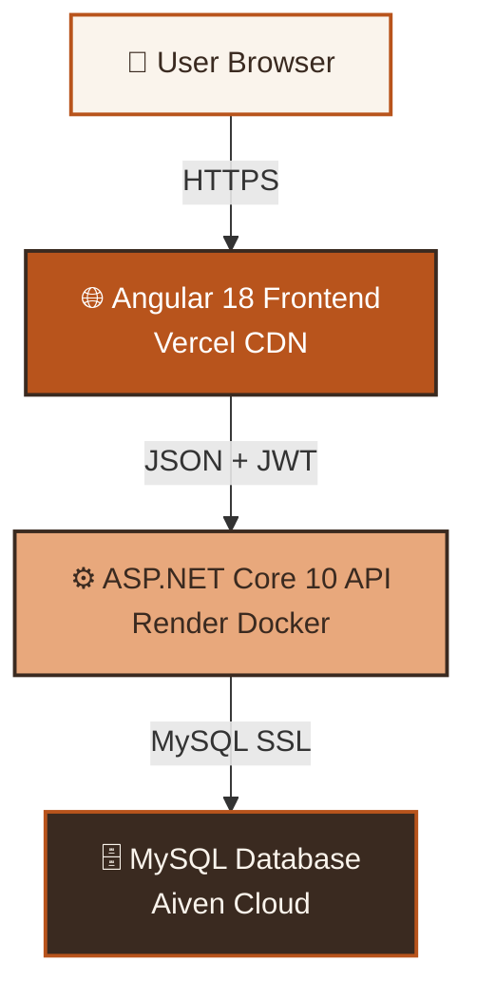

<div align="center">


### ✨ A modern full-stack blogging platform

**Angular 18** · **ASP.NET Core 10** · **MySQL** · **JWT Auth** · **Docker**

<br/>

<a href="https://sphereblogs.vercel.app">
  
</a>
<a href="https://blogsphere-api-vhq2.onrender.com">
  
</a>
<a href="https://github.com/ayushsrivastava-01/BlogSphere">
  
</a>

<br/><br/>


<br/><br/>


</div>

---

<div align="center">

## 🛠️ Tech Stack


</div>

---

## 📸 Screenshots

<div align="center">

### 🏠 Homepage

*Editorial warm theme with animated aurora background*

### 📖 Blog Details

*Clean, card-based reading experience*

### 🔐 Authentication

*JWT-based secure authentication*

</div>

---

## 🎯 About the Project

**BlogSphere** is a **production-ready full-stack blogging platform** where users can:

<table>
<tr>
<td width="50%">

### ✍️ For Writers
- Write and publish stories
- Edit and delete own posts
- Character counter with validation
- Auto-save drafts (coming soon)

</td>
<td width="50%">

### 📖 For Readers
- Browse community posts
- Search by title/content/author
- Clean reading experience
- Responsive on all devices

</td>
</tr>
</table>

The project demonstrates **real-world full-stack development** — from API design and database persistence to frontend integration, authentication, and cloud deployment.

---

## ✨ Features

### 📚 Core Features

<table>
<tr>
<td>

- ✅ **JWT Authentication** — Register & login securely
- ✅ **Blog CRUD** — Full create/read/update/delete
- ✅ **Ownership Authorization** — Only owner can edit/delete
- ✅ **Public Reading** — Anyone can read posts

</td>
<td>

- ✅ **Search** — Filter by title, content, author
- ✅ **Form Validation** — Real-time error messages
- ✅ **Character Counter** — Live length tracking
- ✅ **Protected Routes** — Auth-gated actions

</td>
</tr>
</table>

### 🎨 UI/UX Features

- 🎨 **Editorial Warm Theme** — Sunset palette, serif headings
- 🌌 **Animated Background** — Aurora waves with floating blobs
- 📱 **Fully Responsive** — Mobile, tablet, desktop
- 🎭 **Smooth Scroll** — Navbar smooth-scrolls to sections
- ⬆️ **Back to Top** — Floating animated button
- ✨ **Micro-interactions** — Hover lifts, ripple buttons, card animations
- 🔤 **Custom Fonts** — Playfair Display + Inter

### 🔐 Security Features

- 🔐 **JWT Bearer Tokens** — Stateless authentication
- 🔒 **BCrypt Password Hashing** — Salted & secure
- 🌐 **CORS Policy** — Whitelisted origins only
- 🛡️ **Owner-based Authorization** — Backend-enforced
- 🔑 **Environment Variables** — Zero secrets in code
- ✅ **HTTPS Enforced** — SSL on frontend & backend

---

## 🏗️ Architecture



---

## 📡 API Reference

**Base URL:** `https://blogsphere-api-vhq2.onrender.com`

### 🔐 Authentication Endpoints

<details>
<summary><b>📝 Register New User</b></summary>

```http
POST /api/auth/register
Content-Type: application/json

{
  "name": "Ayush Srivastava",
  "email": "ayush@example.com",
  "password": "securepass123"
}
```

**Response:**
```json
{
  "message": "Registration successful.",
  "user": {
    "id": 1,
    "name": "Ayush Srivastava",
    "email": "ayush@example.com"
  }
}
```

</details>

<details>
<summary><b>🔑 Login</b></summary>

```http
POST /api/auth/login
Content-Type: application/json

{
  "email": "ayush@example.com",
  "password": "securepass123"
}
```

**Response:**
```json
{
  "message": "Login successful.",
  "token": "eyJhbGciOiJIUzI1NiIs...",
  "user": {
    "id": 1,
    "name": "Ayush Srivastava",
    "email": "ayush@example.com"
  }
}
```

</details>

### 📝 Blog Posts Endpoints

| Method | Endpoint | Description | Auth |
|:---:|:---|:---|:---:|
| 🟢 `GET` | `/api/posts` | Get all posts | ❌ |
| 🟢 `GET` | `/api/posts/{id}` | Get post by ID | ❌ |
| 🔵 `POST` | `/api/posts` | Create new post | ✅ |
| 🟡 `PUT` | `/api/posts/{id}` | Update post (owner only) | ✅ |
| 🔴 `DELETE` | `/api/posts/{id}` | Delete post (owner only) | ✅ |

<details>
<summary><b>➕ Create Post Example</b></summary>

```http
POST /api/posts
Authorization: Bearer <JWT_TOKEN>
Content-Type: application/json

{
  "title": "Hello, BlogSphere!",
  "content": "My journey into full-stack development starts here.",
  "author": "Ayush"
}
```

**Response:**
```json
{
  "id": 1,
  "title": "Hello, BlogSphere!",
  "content": "My journey into full-stack development starts here.",
  "author": "Ayush",
  "createdAt": "2026-10-15T10:30:00Z",
  "userId": 1
}
```

</details>

---

## 🚀 Run Locally

### 📋 Prerequisites

<table>
<tr>
<td>🔧 <b>.NET SDK 10</b><br/><a href="https://dotnet.microsoft.com/download">Download</a></td>
<td>🟢 <b>Node.js 20+</b><br/><a href="https://nodejs.org/">Download</a></td>
</tr>
<tr>
<td>🅰️ <b>Angular CLI</b><br/><code>npm i -g @angular/cli</code></td>
<td>🐬 <b>MySQL 8</b> (or Aiven)<br/><a href="https://dev.mysql.com/downloads/">Download</a></td>
</tr>
</table>

### 📥 Clone Repository

```bash
git clone https://github.com/ayushsrivastava-01/BlogSphere.git
cd BlogSphere
```

### ⚙️ Backend Setup

```bash
cd BlogSphere.API
```

**Configure secrets** (User Secrets):

```bash
dotnet user-secrets set "ConnectionStrings:DefaultConnection" "Server=localhost;Port=3306;Database=blogsphere_db;User=root;Password=YOUR_PASSWORD;"
dotnet user-secrets set "Jwt:Key" "YOUR_SUPER_SECRET_KEY_AT_LEAST_32_CHARS"
dotnet user-secrets set "Jwt:Issuer" "BlogSphereAPI"
dotnet user-secrets set "Jwt:Audience" "BlogSphereClient"
dotnet user-secrets set "Jwt:ExpiryMinutes" "1440"
```

**Run migrations & start API:**

```bash
dotnet ef database update
dotnet watch run
```

✅ API runs at `http://localhost:5269`

### 🎨 Frontend Setup

```bash
cd ../BlogSphere.Client
npm install
```

**Update API URL** in these files to `http://localhost:5269/api`:
- `src/app/services/auth.service.ts`
- `src/app/pages/home/home.component.ts`
- `src/app/pages/blog-details/blog-details.component.ts`

**Start dev server:**

```bash
ng serve
```

✅ App runs at `http://localhost:4200`

---

## 📁 Project Structure

```
BlogSphere/
│
├── 🖥️ BlogSphere.API/                    # .NET Backend
│   ├── 📁 Data/
│   │   └── BlogSphereDbContext.cs
│   ├── 📁 DTOs/
│   │   ├── LoginDto.cs
│   │   └── RegisterDto.cs
│   ├── 📁 Models/
│   │   ├── Post.cs
│   │   └── User.cs
│   ├── 📁 Services/
│   │   └── AuthService.cs
│   ├── 📁 Migrations/
│   ├── Program.cs
│   ├── appsettings.json
│   └── Dockerfile
│
├── 🎨 BlogSphere.Client/                 # Angular Frontend
│   ├── 📁 src/
│   │   ├── 📁 app/
│   │   │   ├── 📁 interceptors/
│   │   │   ├── 📁 services/
│   │   │   ├── 📁 pages/
│   │   │   │   ├── 📁 home/
│   │   │   │   ├── 📁 login/
│   │   │   │   ├── 📁 register/
│   │   │   │   └── 📁 blog-details/
│   │   │   ├── app.config.ts
│   │   │   └── app.routes.ts
│   │   ├── styles.css
│   │   └── index.html
│   └── angular.json
│
├── 📸 screenshots/
└── 📖 README.md
```

---

## 🗺️ Roadmap

### ✅ Completed
- [x] ASP.NET Core Web API setup
- [x] MySQL + EF Core integration
- [x] Blog post CRUD endpoints
- [x] JWT authentication
- [x] User registration & login
- [x] BCrypt password hashing
- [x] Owner-based authorization
- [x] Angular frontend (standalone components)
- [x] Responsive editorial UI
- [x] Search functionality
- [x] Form validation
- [x] Blog details page
- [x] Aurora background animations
- [x] Cloud deployment (Render + Vercel + Aiven)

### 🚧 In Progress
- [ ] Mobile hamburger menu
- [ ] User profile page

### 🔮 Planned
- [ ] Comments & likes
- [ ] Rich text editor (Markdown)
- [ ] Image upload
- [ ] Categories & tags
- [ ] Pagination
- [ ] Email notifications
- [ ] Follow users
- [ ] Dark/Light mode toggle
- [ ] Forgot password
- [ ] Social sharing

---

## 🎯 Project Goals

<table>
<tr>
<td align="center">🎓<br/><b>Learn</b><br/>Full-stack from scratch</td>
<td align="center">🏗️<br/><b>Build</b><br/>Production-ready app</td>
<td align="center">🚀<br/><b>Deploy</b><br/>Real cloud infrastructure</td>
<td align="center">💡<br/><b>Grow</b><br/>Best practices & patterns</td>
</tr>
</table>

---

## 🐛 Known Issues

<table>
<tr>
<td>⚠️ <b>Cold Start</b></td>
<td>Render free tier sleeps after 15 min inactivity. First request takes 30-60s to wake up.</td>
</tr>
<tr>
<td>📱 <b>Mobile Nav</b></td>
<td>Hamburger menu not yet implemented. Nav links hidden on small screens.</td>
</tr>
</table>

---

## 🤝 Contributing

Contributions, issues, and feature requests are welcome!

1. 🍴 **Fork** the project
2. 🌿 **Create** your branch (`git checkout -b feature/AmazingFeature`)
3. 💾 **Commit** your changes (`git commit -m 'Add some AmazingFeature'`)
4. 📤 **Push** to the branch (`git push origin feature/AmazingFeature`)
5. 🎉 **Open** a Pull Request

---

## 📄 License

Distributed under the **MIT License**. See [`LICENSE`](./LICENSE) for more information.

---

## 👨‍💻 Author

<div align="center">


### **Ayush Srivastava**

*Aspiring Full-Stack Developer*

<a href="https://github.com/ayushsrivastava-01">
  
</a>
<a href="https://linkedin.com/in/ayushsrivastava">
  
</a>

</div>

---

## 🙏 Acknowledgments

<div align="center">

<table>
<tr>
<td align="center"><br/>Angular</td>
<td align="center"><br/>.NET</td>
<td align="center"><br/>MySQL</td>
<td align="center"><br/>Docker</td>
<td align="center"><br/>Vercel</td>
</tr>
</table>

</div>

---

<div align="center">

### ⭐ If you find this project interesting, consider giving it a star!


<br/>

**Made with ❤️ by [Ayush Srivastava](https://github.com/ayushsrivastava-01)**

</div>
